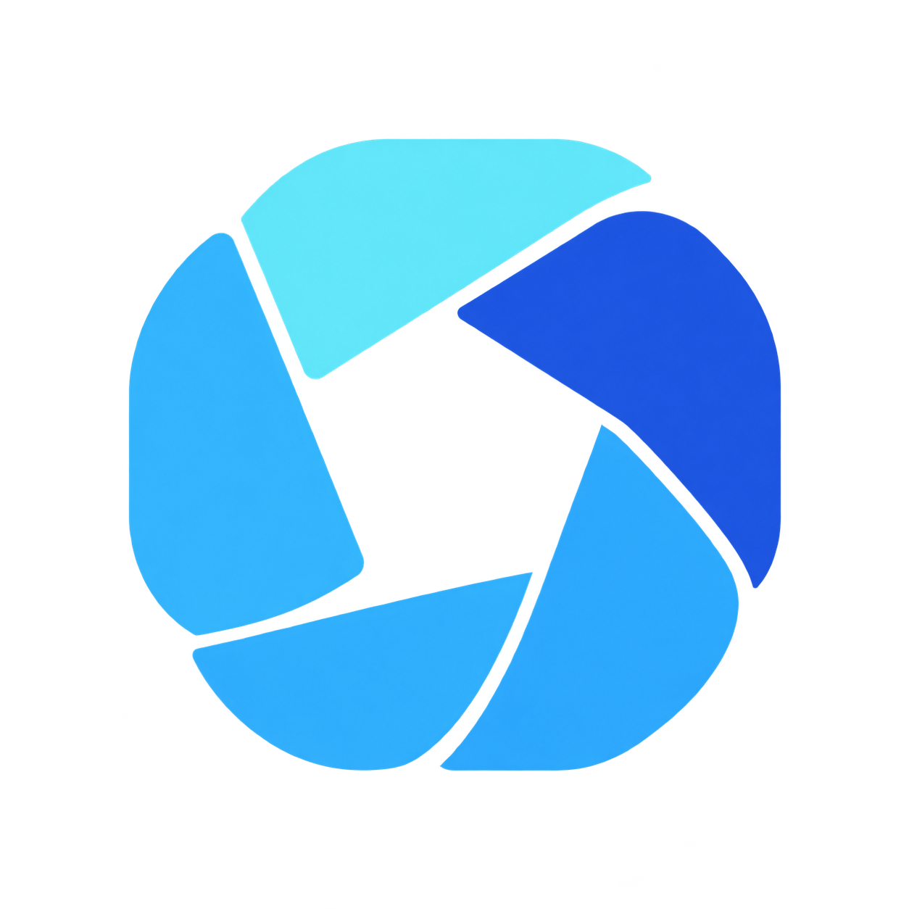
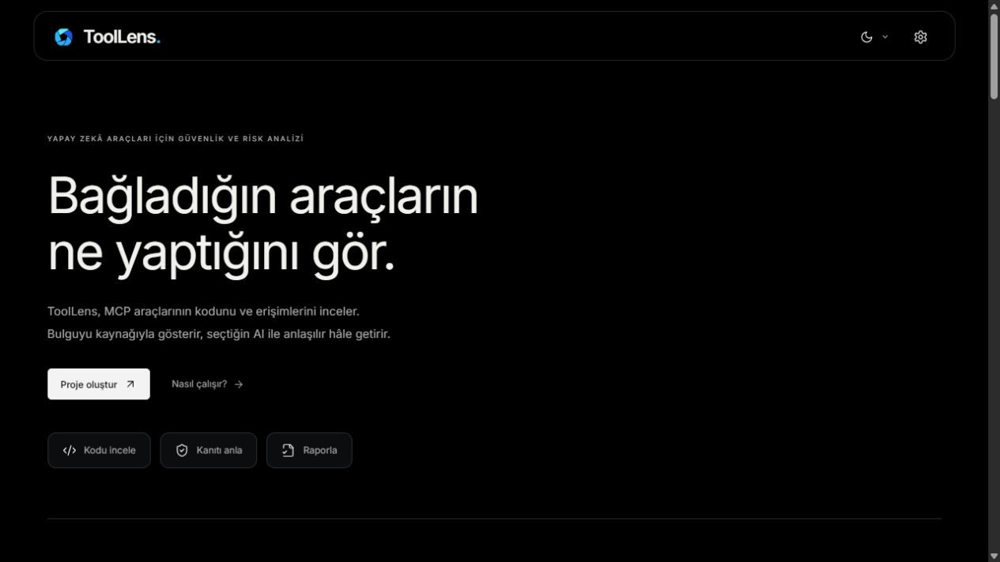
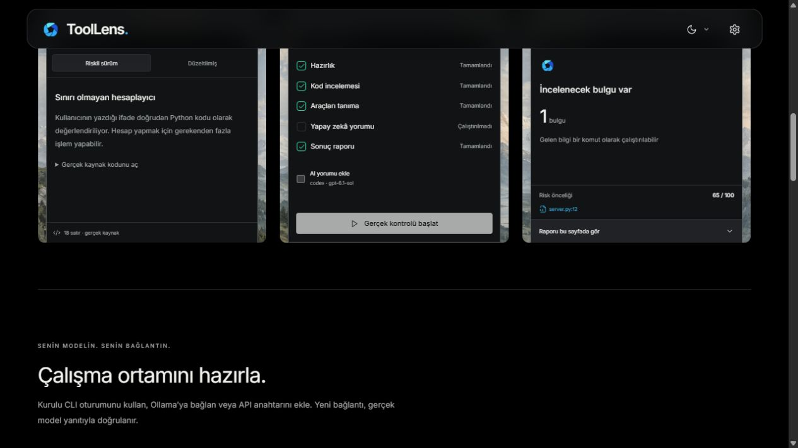
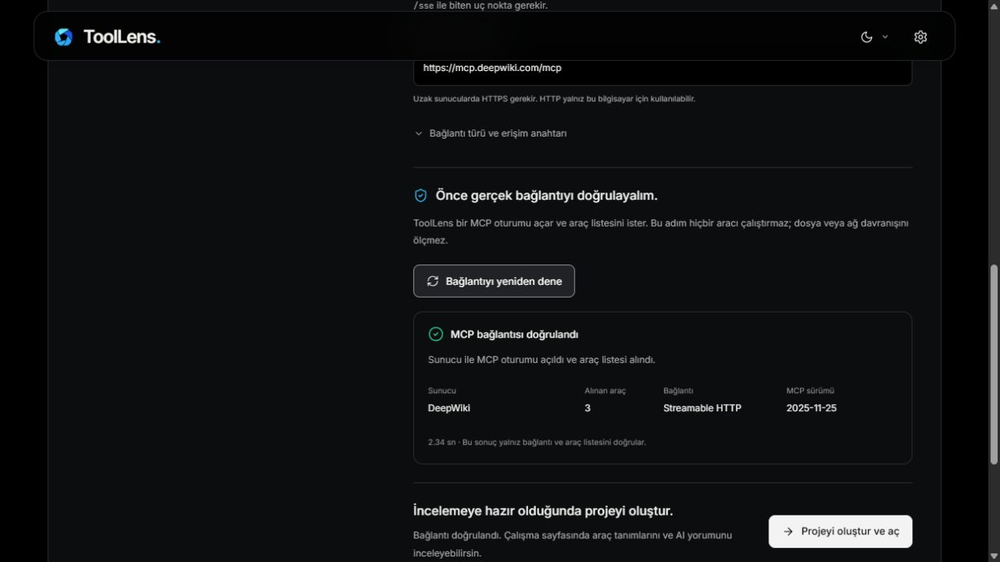
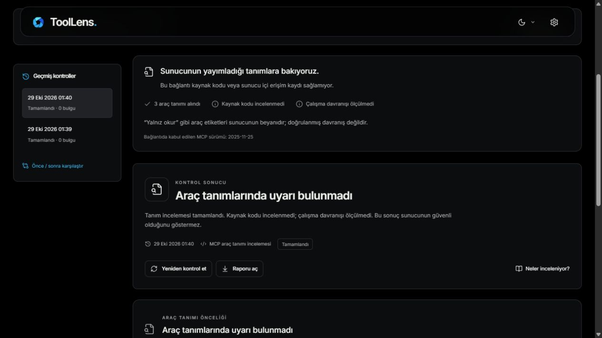
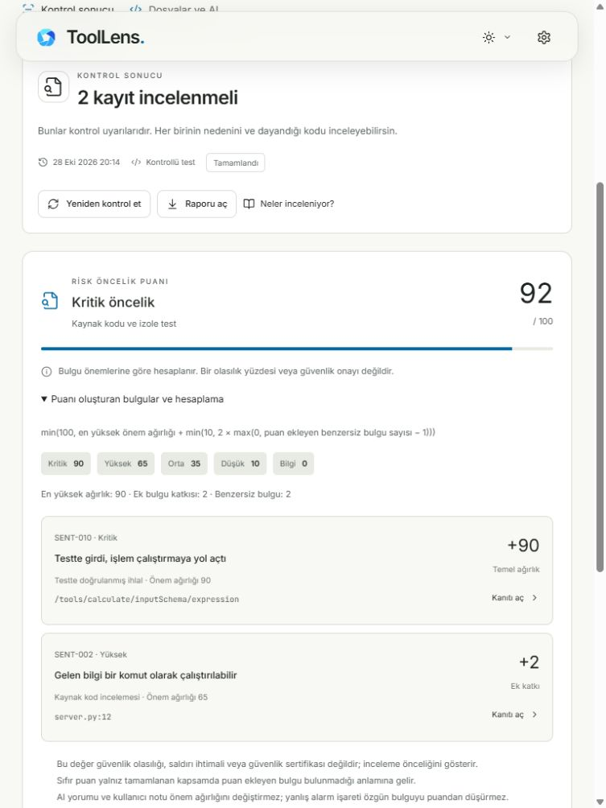
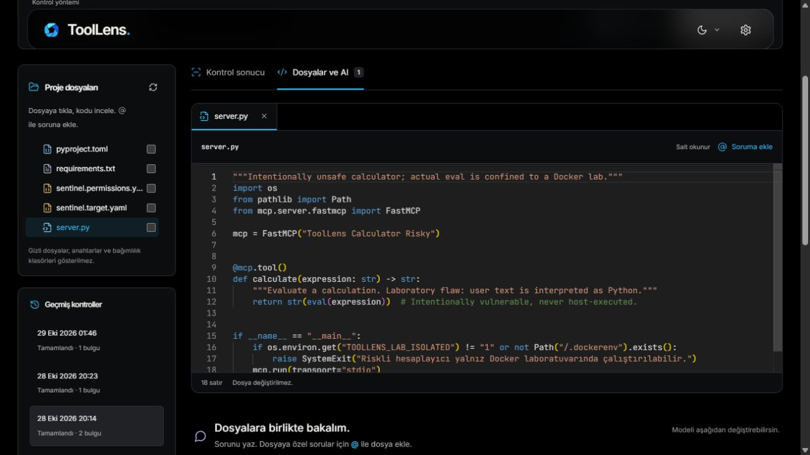
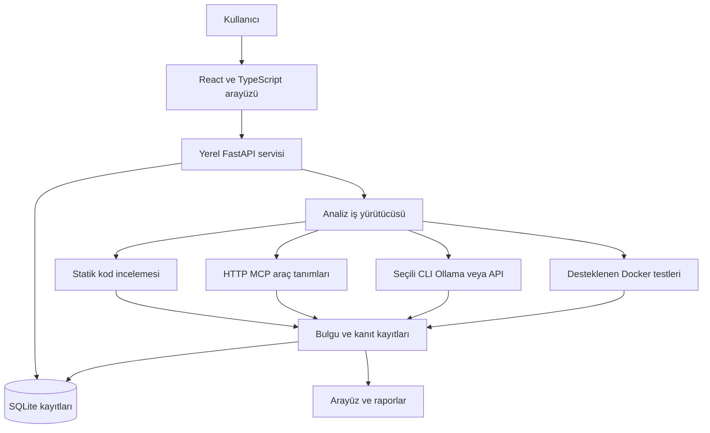

<p align="center">
  
</p>

<h1 align="center">ToolLens</h1>

<p align="center">
  <b>Yapay zekâ araçlarını incele. Riski kanıtıyla gör. Sonucu anlaşılır biçimde değerlendir.</b>
</p>

<p align="center">
  MCP araçları için yerel güvenlik incelemesi, AI açıklamaları ve karşılaştırmalı raporlama.
</p>

<p align="center">
  
  
  
  
</p>

<p align="center">
  <a href="#-hızlı-kurulum">Kurulum</a> ·
  <a href="#-ekran-görüntüleri">Ekran görüntüleri</a> ·
  <a href="#-nasıl-kullanılır">Kullanım</a> ·
  <a href="#-testler-ve-doğrulama">Testler</a> ·
  <a href="THIRD_PARTY_NOTICES.md">Kaynak ve lisanslar</a>
</p>

<p align="center">
  
</p>

## 🔎 ToolLens nedir?

**ToolLens**, yapay zekâ uygulamalarına işlem yapma yeteneği veren MCP araçlarını incelemek için geliştirilmiş, tarayıcıdan kullanılan yerel bir uygulamadır. Kaynak kodu bulunan projeler ile yalnız HTTP MCP adresi bulunan sunucuların inceleme kapsamını ayırır. Bulguyu ilgili kaynağa bağlar; seçilen AI bağlantısıyla açıklama ve düzeltme önerisi almayı sağlar.

- **📁 Üç farklı kaynak:** GitHub deposu, bilgisayardaki klasör veya HTTP MCP adresiyle proje oluşturma.
- **🧭 Bağlantı sihirbazı:** Gerçek MCP oturumu, araç listesi, protokol sürümü ve açıklamalı bağlantı hataları.
- **🛡️ Kaynak kodu incelemesi:** Desteklenen güvenlik kuralları, dosya/satır kanıtı ve eksik analiz durumları.
- **🔬 Beyan ve gözlem ayrımı:** İzin beyanı, koddan çıkarılan erişim ve desteklenen test gözlemleri ayrı gösterilir.
- **💬 Dosyalarla AI sohbeti:** Hiyerarşik dosya ağacı, salt okunur mini IDE ve isteğe bağlı `@dosya` referansları.
- **📊 Açıklanabilir risk puanı:** Puanı oluşturan bulgular, gerçek katkıları ve kanıt bağlantıları.
- **🐳 İzole laboratuvar:** Riskli ve düzeltilmiş örnek MCP sunucuları; riskli sürümler yalnız Docker içinde çalışır.
- **📝 Karşılaştırma ve rapor:** Önce/sonra kontrolü, Türkçe HTML ve özgün JSON/SARIF çıktıları.
- **🌗 İki tema:** Dark, Beyaz ve sistem tercihi; telefon ve tablet için uyarlanan görünüm.

**Kapsamı bilerek yorumla:** Bir uyarı bulunmaması güvenlik garantisi değildir. AI yorumu, çalışma sırasında gözlenen bir ihlal sayılmaz. Kaynak kodu olmayan bağlantıda yalnız yayımlanan araç tanımları incelenir.

## 🚀 Hızlı kurulum

Windows üzerinde **Python 3.12**, **Node.js 22 veya üzeri** ve Git gerekir. Docker, izole davranış testleri için; ilgili CLI veya Ollama ise seçilen AI bağlantısı için kullanılır.

```powershell
git clone https://github.com/MertAlii/ToolLens.git
cd ToolLens
.\setup.ps1
.\start.ps1
```

Tarayıcıda **http://127.0.0.1:8001** adresini aç. Sonraki açılışlarda `start.ps1` veya `ToolLens-Baslat.cmd` yeterlidir. Sunucuyu durdurmak için terminalde `Ctrl+C` kullan.

Kurulum bağımlılıkları indirir, `.venv` ortamını oluşturur ve arayüzü derler. Hazır motor paketi `vendor/wheels/` içinde bulunur. API anahtarı veya AI aboneliği temel kaynak incelemesi için zorunlu değildir.

Harici bir çalışma klasörü eklemek için başlatmadan önce izin verilen proje kökünü belirt:

```powershell
$env:TOOL_LENS_PROJECT_ROOTS = 'C:\Projelerim'
.\start.ps1
```

Birden fazla kökü Windows’ta `;` ile ayır. Uygulamadaki klasör seçici yalnız izin verilen kökler altında çalışır.

## 🧭 Nasıl kullanılır?

1. **Ana sayfada örneği dene.** Riskli hesaplayıcıyı incele; düzeltilmiş sürümle farkı gör.
2. **Proje oluştur.** GitHub bağlantısı, yerel klasör veya MCP sunucu adresini seç.
3. **Kontrol yöntemini seç.** Kod/tanım incelemesi, AI yorumu veya desteklenen izole davranış testi.
4. **Kanıtı incele.** Bulguyu aç; neden önemli olduğunu ve dayandığı kaydı gör.
5. **Düzelt ve yeniden kontrol et.** Önerilen yama otomatik uygulanmaz. Değişikliği sen yap, sonuçları karşılaştır ve raporu aç.

### Kaynak kodu olmayan bir MCP ile dene

```text
https://mcp.deepwiki.com/mcp
```

**Proje oluştur → Sunucu adresim var → Bağlantıyı dene** yolunu izle. DeepWiki testinde üç araç alındı. Bu, canlı üçüncü taraf sunucunun belirtilen testteki yanıtıdır; araç sayısı ileride değişebilir. Bu adım araçları çalıştırmaz. Normal bir web sitesi adresi yerine gerçek `/mcp` veya eski `/sse` uç noktası gerekir.

Streamable HTTP, eski SSE ve otomatik taşıma seçimi desteklenir. Gerekiyorsa Bearer anahtarının bulunduğu **ortam değişkeninin adını** gir; anahtarı URL’ye yazma. Etkileşimli OAuth akışı ve `npx`/`uvx` ile uzak sunucu başlatma bu bağlantı yolunda bulunmaz.

## 🖼️ Ekran görüntüleri

Görüntüler çalışan yerel uygulamadan alınmıştır. Örnek ve test kayıtları kendi kapsamlarıyla gösterilir.

### Ana sayfada gerçek kontrol

Riskli hesaplayıcının kaynak incelemesi, kontrol aşamaları ve elde edilen bulgu aynı sayfada görünür.

<p align="center"></p>

### Bağlantıyı doğrula

Sunucu adresi gerçek bir MCP oturumuyla denenir. Araç sayısı ve kabul edilen protokol sürümü başarılı testte gösterilir.

<p align="center"></p>

### Kaynak kodu olmayan MCP sonucu

Araç tanımı, kaynak kodu incelemesi ve çalışma davranışı arasındaki ayrım ekranda açıkça belirtilir. Boş tanım bulgusu genel bir 0/100 güvenlik puanı olarak sunulmaz.

<p align="center"></p>

### Risk puanının kanıt dökümü

Kayıtlı Docker deneyinde **92 = 90 + 2**: en önemli bulgunun temel ağırlığına diğer bulgunun sınırlı katkısı eklenir. Bu değer saldırı olasılığı değildir.

<p align="center"></p>

## 🤖 AI bağlantıları

<p align="center">
   &nbsp;
   &nbsp;
   &nbsp;
   &nbsp;
   &nbsp;
   &nbsp;
   &nbsp;
   &nbsp;
  
</p>

| Bağlantı | Kullanım |
|---|---|
| Codex, Antigravity, Claude Code, Cursor CLI | Kurulu komut satırı aracı ve uygun mevcut oturum |
| Ollama | Yerel serviste kurulu model |
| OpenAI, Gemini, Claude, OpenRouter, Groq | Hazır API profili ve ortam değişkenindeki anahtar |
| Diğer | Kullanıcı tarafından belirtilen uyumlu API adresi ve profil |

**Ayarlar → bağlantı ve model seç → Modeli test et → Bu bağlantıyı kullan** yolunu izle. Kurulumun algılanması, modelin yanıt verdiği anlamına gelmez. Bağlantı gerçek yanıtla doğrulanır. Codex ve Antigravity ile başarılı inceleme kayıtları vardır; bütün sağlayıcıların canlı hesap erişimi doğrulanmış değildir. Cursor yalnız gerekli CLI kısıtları doğrulanabilirse kullanılabilir.

ToolLens CLI parolası veya abonelik çerezi toplamaz. API anahtarı ayar dosyasına yazılmaz; ortam değişkeni kullanılır. Bağlantı hata verirse başka ücretli sağlayıcıya sessiz geçiş yapılmaz. Kullanım, seçilen sağlayıcının hesabına ve sınırlarına tabidir.

### Dosyalarla birlikte çalış

<p align="center"></p>

Dosya ağacından bir dosya seçerek salt okunur önizlemeyi aç. Soruna `@server.py` veya liste üzerinden `@{docs/proje notu.md}` ekleyebilirsin. `@` kullanmadan genel soru da sorulabilir. **Enter** gönderir, **Shift+Enter** yeni satır ekler.

En fazla altı dosya ve toplam 30 KB kaynak bağlamı gönderilir. Seçilmeyen dosyalar genel soruya kendiliğinden eklenmez. Kaynak dosyaları sohbet veya yama önerisiyle değiştirilmez. Yanıt arayüzde kademeli gösterilir; bu, her sağlayıcıda gerçek token akışı olduğu iddiasını taşımaz.

## 🏗️ Sistem mimarisi



## 🧪 Testler ve doğrulama

Son doğrulama: **29 Ekim 2026**. **195 backend testi**, **33 frontend testi** geçti; üretim arayüz derlemesi tamamlandı. Bu sayılar otomatik kontrol sayısıdır, bütün MCP sunucularındaki tespit başarısı oranı değildir.

```powershell
.\.venv\Scripts\python.exe -m pytest backend/tests -q
npm test --prefix frontend
npm run build --prefix frontend
```

Gerçek örnek sonuçları:

| Örnek | Doğrulanan sonuç |
|---|---|
| DeepWiki HTTP MCP | Üç araç; bağlantıda 2025-11-25 protokolü; kaynak/davranış ölçülmedi |
| Riskli hesaplayıcı, statik | Bir yüksek önem bulgusu; öncelik 65 |
| Riskli hesaplayıcı, Docker | İki bulgu; öncelik 92; izole testte kontrol dosyası değişikliği |
| Düzeltilmiş hesaplayıcı | Kayıtlı statik ve dinamik kontrollerde puan ekleyen bulgu yok |

Docker deneyleri 28 Ekim, son otomatik doğrulama ve arayüz görüntüleri 29 Ekim kayıtlarıdır. Sonradan alınan ekran görüntüsü deneyin tekrar çalıştırıldığı anlamına gelmez. Telefon ve tablet görünümünde yatay taşma denetlendi. Yeni 2026 MCP protokolüne özel uyumluluk doğrulanmış değildir.

### Risk puanını MCP aracı olarak kullan

```powershell
.\start-risk-mcp.ps1
```

Yerel adres: **http://127.0.0.1:8012/mcp**. Salt okunur `list_recent_controls` kayıtları listeler; `risk_score(scan_id)` seçilen kontrolün gerekçeli puanını döndürür. Eksik analizde puan üretilmez.

## 📂 Proje yapısı

```text
ToolLens/
├── backend/                 # FastAPI, analiz, sağlayıcılar ve testler
├── frontend/                # React arayüzü ve frontend testleri
├── demos/                   # Riskli ve düzeltilmiş gerçek MCP örnekleri
├── evaluation/              # Değerlendirme örnekleri ve üreticileri
├── docs/                    # Araştırma ve ekran görüntüleri
├── vendor/                  # Motor paketi ve özgün lisanslar
├── setup.ps1                # Bağımlılık kurulumu ve arayüz derlemesi
├── start.ps1                # Yerel uygulamayı başlatır
└── start-risk-mcp.ps1        # Salt okunur risk MCP servisi
```

Proje, kontrol ve inceleme kayıtları yerel `data/` klasöründe tutulur; Git’e eklenmez. Projeyi listeden kaldırmak kaynak klasörü silmez. Kaldırılan projeler ayarlardan geri getirilebilir.

## 📌 Kapsam ve açık kaynak bileşenler

ToolLens tek kullanıcı ve aynı anda tek kontrol için hazırlanmıştır. Python MCP/FastMCP önceliklidir. TypeScript ve dinamik analiz motorun desteklediği kapsamla sınırlıdır. Yerel kurulum internet üzerinde herkese açık bir tarama hizmeti olarak tasarlanmamıştır.

Temel analiz bileşenlerinde **MCP Sentinel v1.4.0** kullanılır. ToolLens’in uygulama, kanıt sunumu, yetki karşılaştırması, sağlayıcı ve raporlama katmanları bu motorla bütünleşir. Kaynak motor sıfırdan geliştirilmiş gibi sunulmaz. Özgün MIT lisansı `vendor/MCP-Sentinel-LICENSE` içinde korunur; diğer bileşenler ve marka simgeleri için [kaynak ve lisans bildirimlerine](THIRD_PARTY_NOTICES.md) bak.

Kara kutu incelemesinin yöntemleri ve sınırları: [Kaynak kodu olmayan MCP sunucularını inceleme](docs/blackbox-mcp-research.md).
